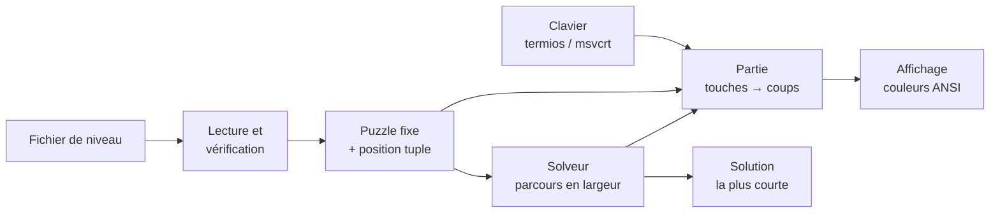

# rush-hour-puzzle

[](https://github.com/Adamz-OG/rush-hour-puzzle/actions/workflows/tests.yml)
[](https://www.python.org/)
[](LICENSE)

Jeu de parking Rush Hour dans le terminal, avec un solveur par parcours en largeur qui trouve la solution la plus courte. Écrit en Python pur (aucune dépendance externe).

```console
$ rushhour solve 1
01  (6x6, 7 cars)
start:
+------------------+
| .  B  B  B  .  . |
| .  .  C  .  D  D |
| A  A  C  .  .  E  →
| .  .  .  .  .  E |
| .  F  F  G  G  G |
| .  .  .  .  .  . |
+------------------+
after the solution:
+------------------+
| .  .  C  B  B  B |
| .  .  C  .  D  D |
| .  .  .  .  A  A  →
| .  .  .  .  .  E |
| F  F  G  G  G  E |
| .  .  .  .  .  . |
+------------------+
shortest solution: 10 moves (limit 15)
positions explored: 610 in 0.005 s
moves: B→2 C↑ A→3 F← G← E↓ A→
```

## Objectif

Le parking est une grille remplie de voitures qui ne se déplacent que dans leur sens, en avant ou en arrière. Il faut libérer le passage pour que la voiture `A` atteigne la sortie, sur le bord droit, sans dépasser un nombre de coups donné.

Le but du projet est d'en faire un vrai jeu, propre et vérifiable : des règles exactes, une logique de jeu séparée de l'affichage et du clavier pour pouvoir tout tester, et un solveur qui calcule la solution la plus courte de chaque niveau. Le solveur sert à la fois d'indice pour le joueur, d'outil pour vérifier les niveaux et de référence pour les tests.

## Fonctionnalités

- **Règles complètes** : déplacement d'une case par coup, voitures horizontales ou verticales, collisions, bords, sortie, limite de coups, abandon.
- **Partie dans le terminal** (`rushhour play`) : plateau en couleurs, sélection d'une voiture par sa lettre, puis déplacement continu avec les flèches tant qu'on ne change pas de voiture.
- **Lecture du clavier sans Entrée** écrite avec la bibliothèque standard : `termios` et `tty` sous Linux et macOS, `msvcrt` sous Windows.
- **Solveur** par parcours en largeur (`rushhour solve`) : solution la plus courte, nombre de positions explorées, plateau avant et après.
- **Indice en jeu** : la touche `?` donne le premier coup d'une solution la plus courte depuis la position actuelle, sans compter de coup.
- **Six niveaux originaux**, de 10 à 66 coups, et lecture de n'importe quel fichier de niveau au même format.
- **Fichiers de niveau vérifiés** : bordures, sortie unique sur la rangée de `A`, voitures droites et nommées dans l'ordre, messages d'erreur précis.
- **Interface de l'énoncé** conservée (`parse_game`, `get_game_str`, `move_car`, `is_win`, `play_game` sur un dictionnaire `game`).
- Script de **benchmark** reproductible, avec comparaison à un parcours en largeur naïf.

## Installation

Python 3.10 ou plus récent.

```bash
git clone https://github.com/Adamz-OG/rush-hour-puzzle.git
cd rush-hour-puzzle
python -m venv .venv
source .venv/bin/activate        # Windows : .venv\Scripts\activate
pip install -e ".[dev]"          # installe la commande rushhour et les outils de test
```

Sans installation, on peut aussi lancer `PYTHONPATH=src python -m rushhour ...` depuis la racine du dépôt.

## Utilisation

### En ligne de commande

```bash
rushhour levels                  # liste des niveaux : taille, limite, solution la plus courte
rushhour play                    # jouer le niveau 1
rushhour play 4                  # jouer le niveau 4
rushhour play mon_niveau.txt     # jouer un fichier de niveau
rushhour solve 6                 # solution la plus courte du niveau 6
rushhour solve 6 --no-color      # sans couleurs ANSI
```

Pendant une partie : une lettre choisit une voiture (`b` ou `B`), les flèches la déplacent d'une case, `?` donne un indice et `Échap` abandonne. La commande `play` se termine avec le code 0 si la partie est gagnée, 1 si les coups sont épuisés et 2 en cas d'abandon, comme le demande l'énoncé.

Un fichier de niveau dessine le parking dans sa bordure, avec une lettre par voiture et `.` pour une case vide. La sortie est un trou dans la bordure droite, sur la rangée de `A`, et la dernière ligne donne le nombre de coups autorisés :

```
+------+
|..CC..|
|..B...|
|AAB....
|......|
+------+
12
```

### Depuis Python

```python
from rushhour import Game, bundled_level, describe, solve

level = bundled_level("3")
solution = solve(level.puzzle, level.start)
print(len(solution), solution.explored)          # 25 2226
print(describe(solution.moves, level.puzzle))    # A←2 B↓ C←2 D↑ E↑ G→ ...

game = Game(level)
game.press("h")                                  # choisir la voiture H
game.press("LEFT")                               # la déplacer d'une case à gauche
print(game.moves, game.outcome)                  # 1 None
game.press("?")
print(game.message)                              # hint: A← (24 moves to the exit)
```

## Tests et qualité

```bash
pytest                       # 337 tests
pytest --cov=rushhour        # couverture : 100 %
ruff check src tests benchmarks
mypy src tests               # typage strict
```

Les tests couvrent chaque module séparément : plateau, fichiers de niveau, solveur, partie, affichage, clavier, interface de l'énoncé et ligne de commande. Plusieurs tests vérifient des propriétés sur des centaines de positions aléatoires plutôt que des exemples :

- **coups de référence** : les coups calculés avec les masques de bits sont exactement ceux qu'on obtient en regardant la grille case par case ;
- **réversibilité** : après tout coup, le coup inverse est permis et ramène la même position, et deux voitures ne se chevauchent jamais ;
- **optimalité** : la longueur trouvée par le parcours en largeur est égale à celle d'une méthode indépendante (point fixe sur toutes les positions accessibles) ;
- **aller-retour** : écrire un niveau puis le relire redonne exactement le même parking.

La lecture du clavier est testée dans un pseudo-terminal (`pty`) pour Linux et macOS, et avec une console simulée pour Windows. La réécriture passe aussi les tests fournis avec l'énoncé (ils ne sont pas inclus dans le dépôt). Un workflow GitHub Actions relance le lint, le typage et les tests sous Python 3.10 à 3.13 à chaque push.

## Résultats

Mesures obtenues avec `python benchmarks/benchmark.py` (Python 3.13, Linux, médiane de 5 essais). « Explorées » compte les positions découvertes avant de trouver la solution, « accessibles » toutes les positions que l'on peut atteindre depuis le départ.

| Niveau | Taille | Voitures | Limite | Solution | Explorées | Accessibles | Solveur | BFS naïf | Rapport |
|---:|---:|---:|---:|---:|---:|---:|---:|---:|---:|
| 1 | 6×6 | 7 | 15 | 10 | 610 | 1 188 | 1,9 ms | 40 ms | × 22 |
| 2 | 6×6 | 9 | 30 | 18 | 39 626 | 70 441 | 224,1 ms | 6 316 ms | × 28 |
| 3 | 6×6 | 11 | 40 | 25 | 2 226 | 2 269 | 12,0 ms | 328 ms | × 27 |
| 4 | 6×6 | 12 | 60 | 37 | 10 590 | 12 905 | 61,2 ms | 1 856 ms | × 30 |
| 5 | 6×6 | 13 | 90 | 58 | 12 619 | 22 455 | 69,4 ms | 2 225 ms | × 32 |
| 6 | 7×6 | 12 | 100 | 66 | 25 922 | 77 757 | 174,4 ms | 5 518 ms | × 32 |

Le « BFS naïf » est le même parcours en largeur écrit sur la représentation de l'énoncé : un dictionnaire `game` copié avec `deepcopy` pour chaque nouvelle position et une grille reconstruite pour tester chaque coup. Les deux trouvent toujours la même longueur.

Ce qu'il faut retenir :

- Le niveau le plus difficile demande **66 coups** au minimum ; le solveur le prouve en 0,17 s après avoir exploré 25 922 positions.
- Les positions sous forme de tuples et les masques de bits rendent le parcours **32 fois plus rapide** que la version naïve sur ce niveau, pour exactement le même résultat (environ 150 000 positions par seconde en Python pur).
- La difficulté ne dépend pas du nombre de positions : le niveau 2 en compte 70 441 mais se résout en 18 coups, le niveau 3 n'en compte que 2 269 pour 25 coups.

Par rapport à ma version de 2024 (mesurée sur les 8 688 positions accessibles des six niveaux, en essayant chaque flèche sur chaque voiture, soit 375 264 tentatives) :

- elle ne détectait **aucune collision** : 30 % des coups interdits étaient acceptés, et la voiture `A` traversait les autres voitures (le niveau 6 était « gagné » en 5 coups au lieu de 66) ;
- une voiture pouvait sortir du parking par le bas ou par la droite, et une voiture de 3 cases ne pouvait plus reculer jusqu'au bord gauche ou haut (4 % des coups permis refusés) ;
- la touche Échap, ou une flèche pressée avant d'avoir choisi une voiture, faisait planter le jeu ;
- la voiture `H` était blanche comme `A`, et seuls 7 des 11 tests fournis avec l'énoncé passaient.

La réécriture n'accepte aucun coup interdit, passe les 11 tests et ajoute le solveur, l'indice et la vérification des niveaux. Tester un coup prend environ une microseconde dans les deux versions : la vitesse compte surtout dans le solveur, qui en teste des centaines de milliers par niveau.

## Comment ça marche



1. **Séparation du fixe et du variable** : un `Puzzle` contient ce qui ne change jamais (taille du parking, orientation, longueur et ligne de chaque voiture). Une position n'est qu'un tuple d'entiers : le décalage de chaque voiture le long de sa ligne.
2. **Masques de bits** : la case `(x, y)` porte le numéro `y × largeur + x`. Pour chaque voiture et chaque décalage, les cases occupées et la case dans laquelle elle entrerait en avançant ou en reculant sont calculées une seule fois. Tester un coup revient à un `&` entre deux entiers.
3. **Coups** : un coup déplace une voiture d'une case, exactement comme une touche dans le jeu. Le compteur de coups du joueur et la longueur de la solution mesurent donc la même chose.
4. **Parcours en largeur** : on part de la position initiale et on visite les positions par distance croissante, avec une file. Chaque position découverte retient la position et le coup qui y mènent. La première position gagnante rencontrée est à distance minimale ; on remonte les parents pour obtenir la solution.
5. **Partie** : la classe `Game` transforme des noms de touches (`"b"`, `"UP"`, `"ESCAPE"`) en coups et en messages, sans jamais lire le clavier ni afficher. La boucle `play` reçoit la lecture des touches et l'affichage en paramètres : les tests jouent des parties entières à partir d'une liste de touches.

## Structure du dépôt

```
rush-hour-puzzle/
├── src/rushhour/
│   ├── board.py        # Puzzle, voitures, positions, masques de bits, coups, victoire
│   ├── level.py        # lecture et écriture des fichiers de niveau, niveaux fournis
│   ├── solver.py       # parcours en largeur, distances, rejeu et texte d'une solution
│   ├── game.py         # partie en cours : touches, coups, messages, fin de partie
│   ├── render.py       # dessin du plateau, couleurs ANSI
│   ├── keyboard.py     # lecture d'une touche (termios/tty ou msvcrt)
│   ├── compat.py       # interface de l'énoncé sur un dictionnaire game
│   ├── cli.py          # commandes play, solve, levels
│   ├── __main__.py     # python -m rushhour
│   └── levels/         # six niveaux originaux, 01.txt à 06.txt
├── tests/              # un fichier de tests par module
├── benchmarks/benchmark.py
├── .github/workflows/tests.yml
├── pyproject.toml
└── LICENSE
```

## Choix techniques

- **Une position immuable, séparée du parking.** Le dictionnaire de l'énoncé mélange ce qui change (les positions) et ce qui ne change pas (taille, orientations, longueurs). En les séparant, une position devient un petit tuple hachable : le solveur la range dans un dictionnaire sans copie profonde, et rien ne peut la modifier par erreur pendant la recherche.
- **Des masques de bits calculés à l'avance.** Les cases occupées par une voiture à chaque décalage, et la case dans laquelle elle entrerait, sont précalculées à la création du `Puzzle`. Un test de collision coûte une opération, quelle que soit la taille de la voiture.
- **Le parcours en largeur plutôt qu'A\*.** Les coups coûtent tous 1 et les niveaux comptent au plus quelques dizaines de milliers de positions : le parcours en largeur trouve la solution la plus courte sans heuristique à justifier, et il est simple à prouver et à tester.
- **Un coup égale une case.** C'est l'unité de l'énoncé (le compteur du joueur avance d'un à chaque flèche). La solution annoncée est donc directement comparable à la limite de coups du niveau.
- **Une logique sans terminal.** `Game` ne lit pas le clavier et n'affiche rien ; `play` reçoit ces deux fonctions. Toute la logique est testée sans terminal, et la même boucle sert à la ligne de commande et à l'interface de l'énoncé.
- **Ma propre lecture du clavier.** Le mode brut est activé seulement le temps de lire une touche, sans vider les touches déjà tapées, puis le terminal est toujours remis dans son état d'origine. Une flèche envoie trois octets (`ESC [ A`) : on attend 50 ms pour distinguer une flèche d'un Échap seul. Le décodage est une fonction pure, testée séparément.
- **Des niveaux générés puis vérifiés.** J'ai créé les six niveaux en plaçant des voitures au hasard, puis en cherchant la position la plus éloignée de toute position gagnante (un parcours en largeur qui part de toutes les positions gagnantes à la fois). La limite de coups vaut 1,5 fois la solution la plus courte, arrondie au multiple de 5 supérieur.
- **L'interface de l'énoncé gardée à part.** `compat.py` reprend les cinq fonctions demandées, avec leurs signatures, au-dessus du nouveau moteur, et ne modifie que les positions dans le dictionnaire `game`.

## Limites et pistes

- Le solveur compte les coups case par case. La mesure classique de Rush Hour compte un glissement de plusieurs cases comme un seul coup : ce serait une seconde option du parcours en largeur.
- Le parcours en largeur garde en mémoire toutes les positions découvertes. Pour de très grands parkings, un A\* avec une heuristique admissible (nombre de voitures qui bloquent `A`) ou un parcours bidirectionnel explorerait moins de positions.
- Il n'y a ni annulation du dernier coup, ni sauvegarde, ni tableau des scores.
- L'affichage suppose un terminal qui comprend les couleurs ANSI ; l'option `--no-color` donne un affichage en texte simple.
- Les niveaux sont générés au hasard puis filtrés : un générateur intégré, avec une difficulté demandée, serait une suite naturelle.

## Ce que j'ai appris

- **Séparer la logique de l'affichage et des entrées** : c'est ce qui rend un jeu interactif entièrement testable, et ce qui m'a permis de trouver les bugs de ma première version.
- **Modéliser un problème comme un graphe** : chaque position est un sommet, chaque coup une arête, et la solution la plus courte devient un parcours en largeur.
- Choisir une **représentation des données** adaptée à l'algorithme : tuples immuables et masques de bits plutôt qu'un dictionnaire copié à chaque étape, et mesurer le gain (32 fois plus rapide).
- **Mesurer plutôt que croire** : mon ancien rapport disait que les collisions étaient gérées, alors qu'aucune n'était détectée. Un test qui essaie tous les coups sur des milliers de positions l'a montré tout de suite.
- Parler au **terminal** : mode brut, séquences d'échappement des flèches, différences entre POSIX et Windows.
- Organiser un projet Python propre : paquet `src/`, données de paquet, `pyproject.toml`, Pytest, ruff, mypy strict, intégration continue.

## Contexte

Projet réalisé à l'origine en 2024 dans le cadre du cours INFO-F106 Projet d'informatique à l'Université libre de Bruxelles (ULB), puis entièrement réécrit en 2026 : règles corrigées, logique séparée de l'affichage, lecture du clavier, solveur, niveaux originaux, tests et mesures.

## Licence

MIT, voir [LICENSE](LICENSE).
